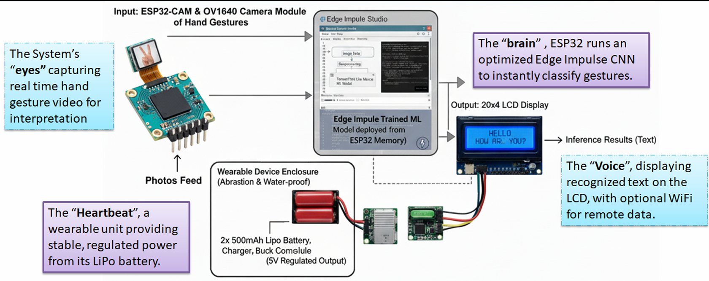
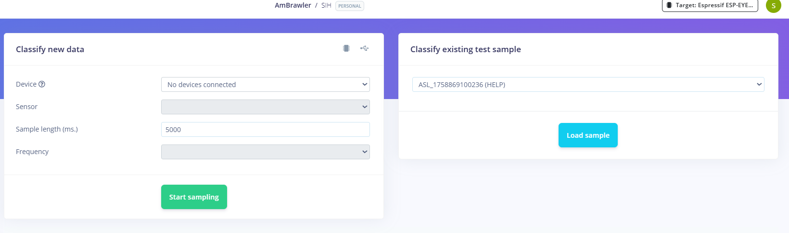
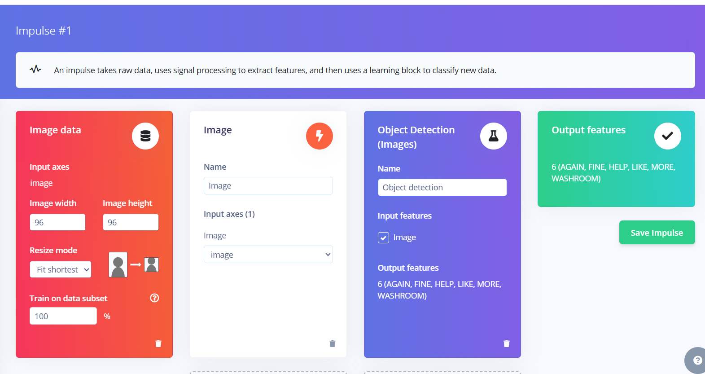
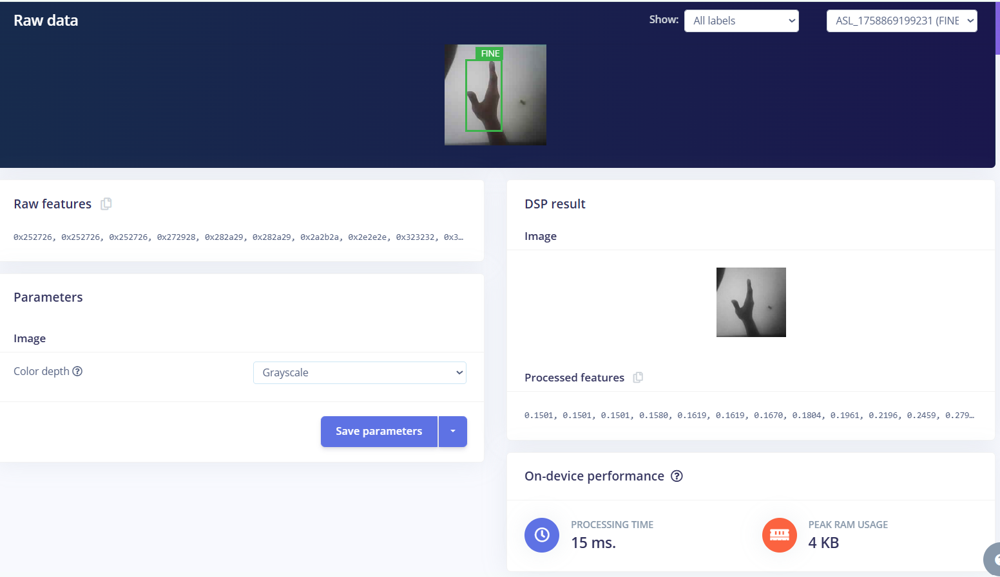
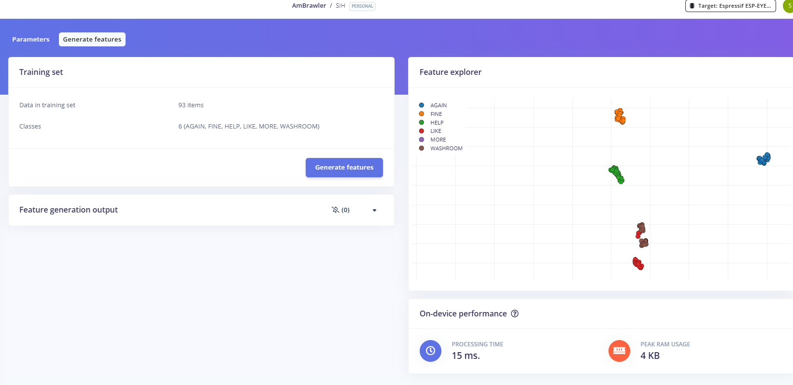
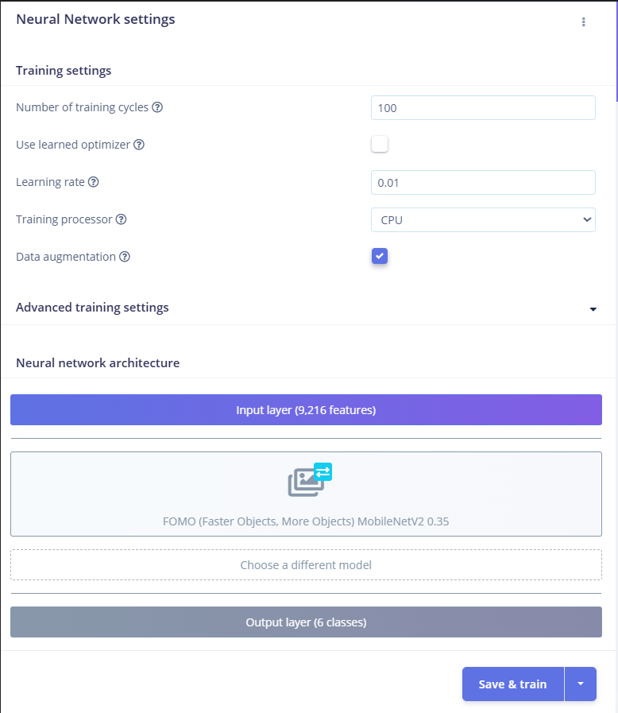
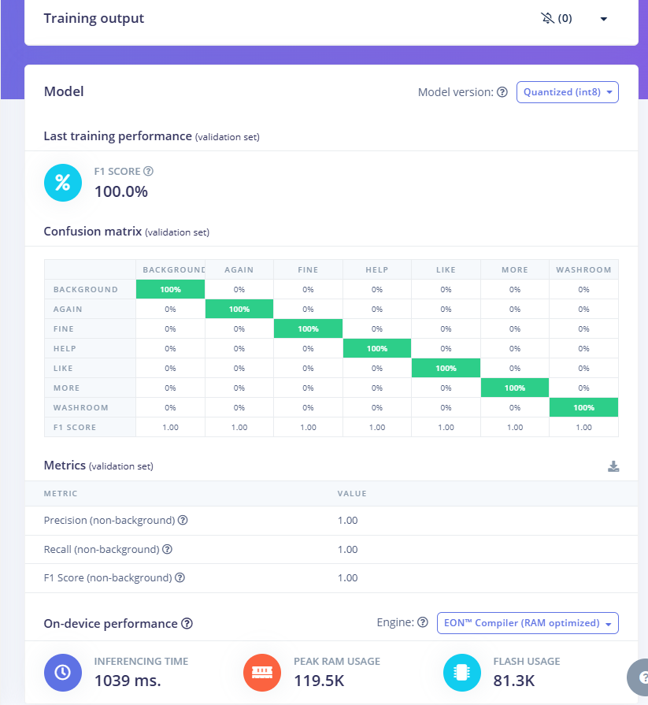
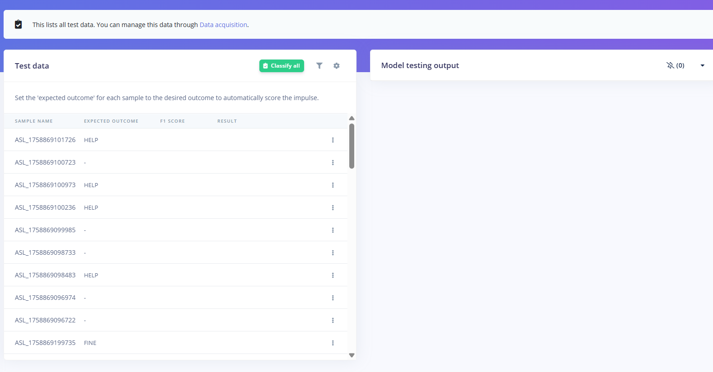
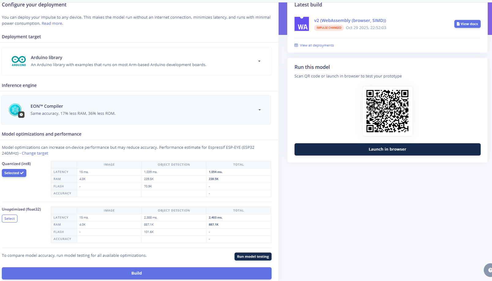
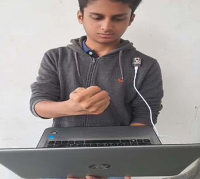

# LEXORA – Smart Wearable ASL-to-Speech Device

## Overview

LEXORA is a wearable assistive device designed to make communication easier for people with speech disabilities. The system uses an ESP32-CAM with an OV2640 camera to capture hand signs and an on-device machine learning model to recognize them in real time. The recognized sign is then converted into text and displayed on an LCD.

## Problem Statement

People with speech disabilities can face difficulties communicating with people who do not understand sign language. Although assistive communication devices are available, many existing solutions can be expensive, bulky, or dependent on glove-based systems, which may not be practical for everyday use.

LEXORA was developed to address this gap by exploring a low-cost, wearable, and natural way of recognizing hand signs. Instead of requiring the user to wear a sensor-filled glove, the system uses a camera attached to a clothing-mounted harness to observe hand gestures and performs the recognition directly on the ESP32-CAM.

This approach aims to make the device more portable and allow users to communicate using their normal hand movements.

## Key Features

- Wearable and compact design
- Real-time sign recognition
- On-device machine learning
- Camera-based gesture detection
- Offline functionality
- Low-cost hardware
- Edge AI processing
- Expandable sign vocabulary

## System Architecture

The system captures hand gestures through the OV2640 camera connected to the ESP32-CAM. The captured image is processed by the deployed machine learning model, and the recognized gesture is converted into text for display on the LCD.

*Figure: System architecture of LEXORA, from camera input and on-device gesture recognition to text output on the LCD.*

## Hardware Components

| Component | Usage in LEXORA |
|---|---|
| ESP32-CAM | Main controller that processes camera frames and runs the deployed ML model. |
| OV2640 Camera | Captures live images of the user's hand gestures. |
| LCD Display | Displays the recognized hand sign as text. |
| LiPo Battery | Provides portable power for the wearable device. |
| BMS Module | Manages and protects the LiPo battery during operation. |
| LM2596 Buck Converter | Steps down the battery voltage to a suitable level for the ESP32-CAM. |

## Software Components

| Software / Technology | Usage in LEXORA |
|---|---|
| Arduino IDE | Used for programming and deploying firmware to the ESP32-CAM. |
| Edge Impulse | Used for preparing the dataset, training, evaluating, and deploying the gesture recognition model. |
| TensorFlow | Used for training the CNN-based hand sign recognition model. |
| TensorFlow Lite Micro | Used to deploy the optimized ML model for inference on the ESP32-CAM. |
| Embedded C/C++ | Used to implement the embedded system logic and hardware control. |

## Dataset

The dataset was prepared to train the model to recognize a set of predefined hand signs. The images were collected and organized into separate classes based on the gesture being performed.

### Gesture Classes

The current dataset contains six hand-sign classes:

- `AGAIN`
- `FINE`
- `HELP`
- `LIKE`
- `MORE`
- `WASHROOM`

Each image is labelled according to its corresponding gesture, allowing the model to learn the visual differences between the signs.

### Dataset Preparation

- Hand gesture images were collected for each class using the OV2640 camera instead of an online dataset.
- Images were organized and labelled according to the corresponding sign.
- The dataset was uploaded to Edge Impulse for further processing and model development.
- The images were prepared for the selected image-processing pipeline before training.

## Edge Impulse Workflow

### 1. Data Collection and Upload

- Collected and labelled images for six gesture classes: AGAIN, FINE, HELP, LIKE, MORE, and WASHROOM.
- The training set contains 93 image samples across the six classes.
- Images were uploaded and organized class-wise in Edge Impulse before creating the impulse.

### 2. Create Impulse

- Configured the input as an image classification problem.
- Used an input resolution of 96 × 96 pixels to keep the input size small enough for embedded deployment.
- Selected the image-processing and learning blocks required for the gesture classification pipeline.

### 3. Image Preprocessing

- Converted the input images to grayscale before feature extraction.
- Grayscale reduces the amount of image information the model has to process while retaining the shape and structural information needed to distinguish the hand signs.
- This helps reduce the computational and memory requirements for deployment on the ESP32.

### 4. Feature Extraction

- Generated image features from the preprocessed gesture samples.
- The Feature Explorer shows how samples from the six classes are distributed in the extracted feature space.
- The relatively distinct clusters indicate that the selected preprocessing and feature representation provide useful separation between several gesture classes.

### 5. Model Training

- Trained the image classification model using the extracted features.
- Used a learning rate of 0.01 to control the size of parameter updates during training.
- The learning rate was kept at this value to provide sufficiently large updates while training the small gesture-classification network.

### 6. Model Evaluation

- Evaluated the trained classifier using the validation data.
- Used the confusion matrix to check which gesture classes were correctly recognized and where misclassification occurred.

### 7. Model Testing

- Tested the trained model with samples that were not used during training.
- Compared the predicted class and confidence score with the actual gesture label.
- This step helped verify whether the model could generalize beyond the training samples.

### 8. Model Deployment

- Prepared the trained model for deployment on the ESP32-CAM target.
- Selected Quantized INT8 deployment to reduce model size and computational requirements.
- INT8 quantization converts the model's numerical representation from higher-precision values to 8-bit integers, making it more suitable for the limited memory and processing capability of the microcontroller.
- This is particularly useful for the project because inference is performed locally on the embedded device rather than sending images to a PC or cloud service.

## Hardware Prototype

- Compact and wearable device arrangement.
- ESP32-CAM used for capturing hand gestures.
- Camera positioned to get a clear view of hand movements.
- Hardware components connected to enable real-time operation.
- Portable design for everyday use.

*Figure: Privacy-preserving, AI-generated representation of the developed wearable prototype, illustrating the camera module mounted on the user's clothing and its USB connection to a laptop.*

## Real-Time Demonstration

- User performs a hand gesture.
- ESP32-CAM captures the gesture.
- Trained model processes the captured input.
- Predicted gesture is identified.
- Corresponding text output is displayed.

*Figure: Demonstration of the system identifying a hand sign using the trained model.*

## Results

The LEXORA system was trained and evaluated using Edge Impulse. The following results highlight the model's classification performance, computational requirements, and suitability for deployment on embedded hardware.

### Model Training and Classification

- The model was trained to recognize six gesture classes: AGAIN, FINE, HELP, LIKE, MORE, and WASHROOM.
- A total of 93 training samples were used for feature generation.
- The neural network was trained for 100 cycles with a learning rate of 0.01.
- Data augmentation was enabled to improve the model's ability to handle variations in input images.
- The FOMO MobileNetV2 0.35 architecture was selected for object detection.

### Model Evaluation

- The model achieved a 100% validation F1 score on the Edge Impulse validation dataset.
- **Validation precision:** 1.00 (100%).
- **Validation recall:** 1.00 (100%).
- **Validation F1 score:** 1.00 (100%).
- The confusion matrix showed 100% correct classification for each of the six gesture classes in the displayed validation results.

### Processing Performance

- Image feature generation takes approximately 15 ms.
- Peak RAM usage during feature generation is approximately 4 KB.
- The input image is processed at a resolution of 96 × 96 pixels using grayscale conversion.

### Embedded Deployment Performance

The model was configured for the Espressif ESP-EYE (ESP32, 240 MHz) target using the EON Compiler with RAM optimization.

Quantized INT8 was selected for deployment because it significantly reduces memory requirements and inference latency compared with the unoptimized Float32 model.

| Performance Metric | Quantized INT8 | Float32 |
|---|---:|---:|
| Image processing latency | 15 ms | 15 ms |
| Object detection latency | 1,039 ms | 2,388 ms |
| Total latency | 1,054 ms | 2,403 ms |
| RAM usage | 239.5 KB | 887.1 KB |
| Flash usage | 70.9 KB | 101.6 KB |

### Key Observations

- INT8 quantization reduces total inference latency by approximately 56.1%.
- RAM usage is reduced by approximately 73% compared with Float32.
- Flash usage is reduced by approximately 30.2%.
- The quantized model provides a more memory-efficient deployment option for resource-constrained embedded devices.

Overall, the results demonstrate promising validation performance and a significantly smaller computational footprint with INT8 quantization, making it a suitable choice for the LEXORA wearable prototype.

## Challenges and Learnings

- **Camera positioning:** Maintaining a suitable camera angle and distance is important for capturing hand gestures clearly and consistently.
- **Lighting conditions:** Variations in brightness and shadows can affect the quality of captured gesture images and may influence recognition performance.
- **Gesture similarity:** Some hand gestures may have similar visual features, making accurate classification more challenging.
- **Embedded deployment:** Working with Edge Impulse helped demonstrate how a trained machine learning model can be prepared for deployment on an embedded platform.

## Future Improvements

- **Additional gesture classes:** Expand the dataset and model to recognize a larger number of gestures, allowing users to communicate a wider range of messages.
- **Multilingual support:** Introduce multiple language options so that recognized gestures can be converted into text in different languages.
- **Audio output:** Integrate text-to-speech functionality to convert recognized gestures into spoken words, making communication easier for people around the user.
- **Better recognition accuracy:** Improve the dataset with more variations in hand positions, backgrounds, lighting conditions, and users.
- **Extended real-world testing:** Test the device under different environments and usage conditions to evaluate its reliability beyond controlled demonstrations.
